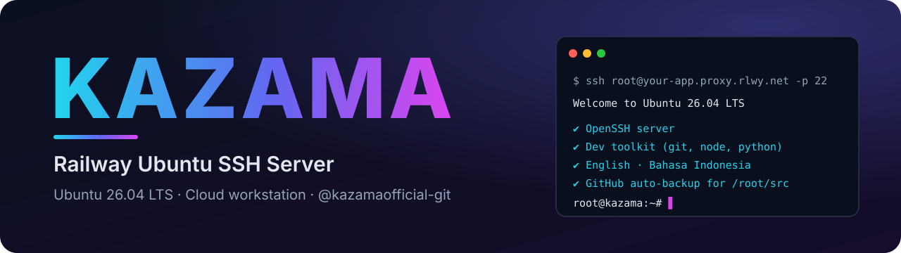
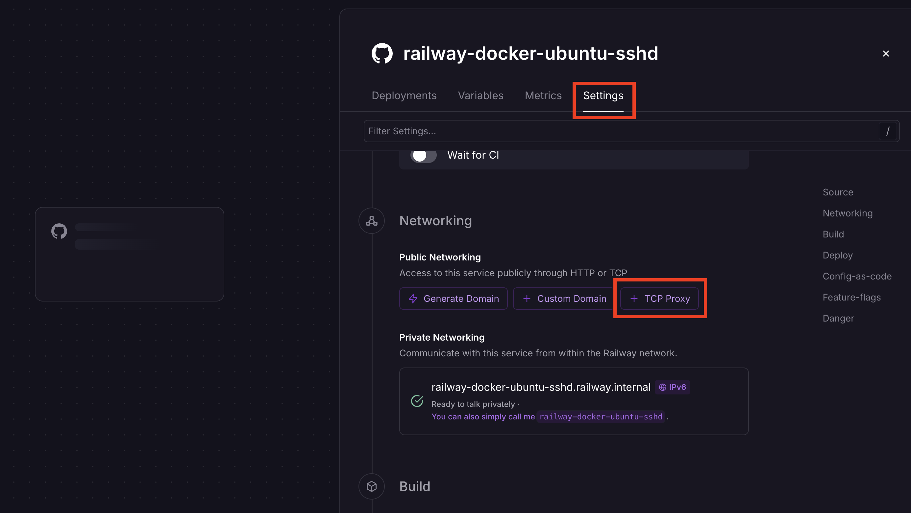
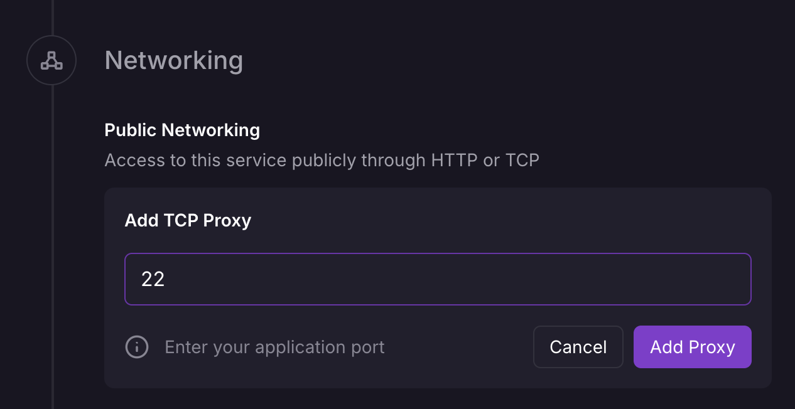
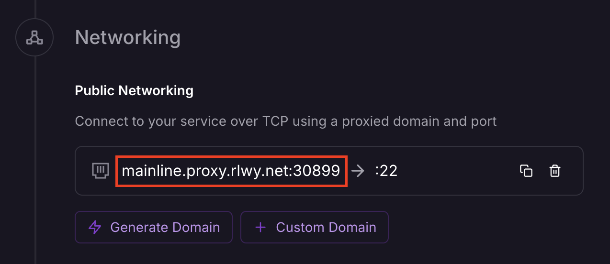

<p align="center">
  
</p>

<h1 align="center">Kazama — Railway Ubuntu SSH Server 🚂</h1>

<p align="center">
  <b>Workstation cloud milik Anda sendiri di Railway</b> — masuk via SSH sebagai <b>root</b> di <b>Ubuntu 26.04 LTS</b>
  lengkap dengan toolkit developer, pesan dwibahasa, dan backup GitHub otomatis (opsional).
</p>

<p align="center">
  🇬🇧 <a href="README.md">English</a> &nbsp;·&nbsp; 🇮🇩 Bahasa Indonesia
</p>

<p align="center">
  
  
  
  
  
</p>

<p align="center">
  <a href="https://railway.com/new"></a>
</p>

---

Image Docker untuk **Railway** yang menjalankan container **Ubuntu 26.04** dengan **server OpenSSH**, **password root wajib**, toolkit developer lengkap, serta **backup GitHub privat** (opsional) untuk folder kerja Anda. Hubungkan lewat SSH dan pakai sebagai workstation cloud yang portabel.

## ✨ Fitur

- 🐧 Base image **Ubuntu 26.04 LTS**
- 🔑 **Login root langsung** via SSH dengan **`ROOT_PASSWORD` wajib** — container menolak berjalan tanpanya
- 👤 **User sudo** tambahan (`SSH_USERNAME` / `SSH_PASSWORD`) dan **login SSH key** (`AUTHORIZED_KEYS`) bersifat opsional
- 🧰 Toolkit developer: `git`, `tmux`, `vim`/`nano`/`micro`, `htop`/`btop`, `ripgrep`, `bat`, `fd`, `jq`, `zsh`, Python 3, Node.js + npm, build tools
- ☁️ **`src-sync`** — backup otomatis `/root/src` ke repo GitHub **privat** dan dipulihkan setiap redeploy
- 📊 **`usage`** — monitor kredit trial & uptime Railway
- 🌍 **English + Indonesia** — locale (`en_US.UTF-8`, `id_ID.UTF-8`) dan pesan runtime (`APP_LANG=id`)
- 🎨 Banner login Kazama dengan info sistem langsung
- 🧹 Struktur `rootfs/` yang rapi, `tini` sebagai PID 1, ShellCheck + Docker build di CI

## ⚠️ Penting

**Railway menjalankan container, bukan VPS.** Semua yang disimpan di container **hilang setiap redeploy** — file, paket terpasang, dan perubahan konfigurasi. Simpan pekerjaan Anda di `/root/src` dan isi `GITHUB_TOKEN` agar dibackup otomatis, atau pasang Railway Volume.

## 🚀 Deploy ke Railway

1. **Fork** atau clone repository ini lalu hubungkan ke project **Railway** baru.
2. Buka **Variables** dan isi `ROOT_PASSWORD` (wajib).
3. Buka **Settings → Networking → Public Networking** lalu klik **TCP Proxy**.

   

4. Masukkan port **`22`** dan tekan **Add Proxy**.

   

5. **Redeploy**. Railway akan menampilkan domain dan port yang dipakai:

   

6. Hubungkan:

   ```bash
   ssh root@<domain-railway-anda> -p <port>
   ```

   Ketik `yes` untuk menerima host key, lalu masukkan `ROOT_PASSWORD` Anda.

## 🌱 Variabel lingkungan

| Variabel | Wajib | Default | Keterangan |
|----------|:-----:|---------|------------|
| `ROOT_PASSWORD` | ✅ | — | Password user **root**. Container tidak akan berjalan tanpanya. |
| `SSH_USERNAME` | — | — | User sudo tambahan (opsional). Isi bersamaan dengan `SSH_PASSWORD`. |
| `SSH_PASSWORD` | — | — | Password untuk user sudo tambahan. |
| `AUTHORIZED_KEYS` | — | — | Public key SSH untuk login root dengan key (login password tetap aktif). |
| `GITHUB_TOKEN` | — | — | Token GitHub (scope `repo`). Mengaktifkan backup `/root/src` ⇄ repo privat. |
| `SYNC_INTERVAL` | — | `180` | Jeda backup otomatis dalam detik (minimum 30). |
| `SRC_REPO` | — | — | Tentukan nama repo backup, mis. untuk memulihkan ke project Railway yang baru. |
| `RAILWAY_TOKEN` | — | — | **Account token** Railway agar `usage` membaca sisa kredit yang sebenarnya. |
| `APP_LANG` | — | `en` | Bahasa pesan runtime: `en` atau `id`. |

> 🔑 Butuh token GitHub? Ikuti panduan langkah demi langkah di **[docs/TOKENS.id.md](docs/TOKENS.id.md)**.

## ☁️ Backup pekerjaan — `src-sync`

Taruh proyek Anda di **`/root/src`**. Dengan `GITHUB_TOKEN` terisi, Kazama akan:

1. membuat repo **privat** bernama `kazama-src-<railway-project-id>` di akun Anda,
2. **memulihkannya** ke `/root/src` pada setiap (re)deploy,
3. **mem-push** perubahan setiap `SYNC_INTERVAL` detik di latar belakang.

```bash
src-sync              # backup sekarang
src-sync restore      # tarik repo ke /root/src
src-sync status       # lihat repo terhubung dan commit terakhir
src-sync init         # buat / hubungkan ulang repo
```

`.gitignore` bawaan (`node_modules/`, `.venv/`, `*.log`, …) ditambahkan saat backup pertama. Token dikirim lewat HTTP header per perintah — tidak pernah ditulis ke URL remote maupun `.git/config`.

## 📊 Penggunaan Railway — `usage`

```bash
usage
```

Menampilkan kredit trial terpakai/sisa, laju pemakaian, dan sisa uptime. Tanpa token hasilnya berupa **estimasi** dari CPU/RAM container dan lama berjalan; isi `RAILWAY_TOKEN` untuk data langsung. Tarif dan jumlah trial bisa diubah lewat `RAILWAY_VCPU_RATE`, `RAILWAY_MEM_RATE`, `RAILWAY_EGRESS_RATE`, dan `RAILWAY_TRIAL_CREDIT`.

## 🗂️ Struktur proyek

```text
.
├── Dockerfile                      # Image Ubuntu 26.04 (ARG UBUNTU_VERSION)
├── railway.json                    # Konfigurasi build/deploy Railway
├── railway-template.json           # Manifest template (service, variabel, TCP proxy)
├── rootfs/                         # Disalin apa adanya ke dalam image
│   ├── etc/
│   │   ├── profile.d/kazama-welcome.sh      # Banner login SSH
│   │   └── ssh/sshd_config.d/10-kazama.conf # Pengaturan sshd
│   └── usr/local/
│       ├── bin/
│       │   ├── kazama-entrypoint            # Logika start container
│       │   ├── src-sync                     # Backup / restore GitHub
│       │   └── usage                        # Monitor penggunaan Railway
│       └── lib/kazama/common.sh             # Helper bersama (i18n, config, logging)
├── docs/                           # Panduan token (EN / ID)
├── assets/                         # Banner + screenshot
└── .github/workflows/ci.yml        # ShellCheck + Docker build
```

## 📦 Paket terpasang

| Kelompok | Paket |
|----------|-------|
| Jaringan | `curl` `wget` `iproute2` `iputils-ping` `net-tools` `dnsutils` `traceroute` `whois` `inetutils-telnet` `nmap` |
| Editor | `vim` `nano` `micro` |
| Monitoring | `htop` `btop` `ncdu` `fastfetch` |
| Terminal | `tmux` `screen` `less` `tree` `bat` `ripgrep` `fd-find` `jq` `zsh` |
| Arsip | `unzip` `zip` `tar` `gzip` `bzip2` `xz-utils` `7zip` |
| Pengembangan | `git` `build-essential` `cmake` `pkg-config` `autoconf` `automake` `libtool` `python3` (`pip`, `venv`, `dev`) `nodejs` `npm` |
| Locale | `locales` `language-pack-en` `language-pack-id` |

`bat` dan `fd` sudah di-link ke nama pendeknya. Paket lain: `apt-get install <paket>`.

## 🔒 Keamanan

- **`ROOT_PASSWORD` wajib** — gunakan password panjang dan unik, lalu ganti setelah login pertama.
- Utamakan login dengan key: isi `AUTHORIZED_KEYS`, lalu pertimbangkan menonaktifkan login password di `rootfs/etc/ssh/sshd_config.d/10-kazama.conf` pada fork Anda.
- Jaga kerahasiaan semua token — Variables Railway yang ditandai secret otomatis disamarkan.
- sshd membatasi 4 percobaan autentikasi per koneksi; koneksi idle dijaga tetap hidup untuk TCP proxy Railway.

## 🩺 Pemecahan masalah

| Masalah | Solusi |
|---------|--------|
| Tidak bisa terhubung | Pastikan **TCP Proxy di port `22`** sudah ada dan gunakan domain **beserta port** dari Railway. |
| Container crash saat start | `ROOT_PASSWORD` belum diisi — cek log deploy. |
| `src-sync: GITHUB_TOKEN belum diatur` | Isi variabelnya lalu **redeploy sekali**; token disimpan saat container start. |
| "Gagal membuat repo" | Token harus memiliki scope **`repo`** (token classic). |
| `usage` menampilkan ESTIMATE | Isi `RAILWAY_TOKEN` (account token) untuk data langsung. |
| File hilang setelah redeploy | Memang begitu di Railway — gunakan `/root/src` + `GITHUB_TOKEN`, atau Volume. |

## 🛠️ Build lokal

```bash
docker build -t kazama-ssh .
docker run -d --name kazama -p 2222:22 -e ROOT_PASSWORD='ganti-ini' kazama-ssh
ssh root@localhost -p 2222
```

## 📄 Lisensi

Dirilis di bawah Lisensi MIT — lihat [LICENSE](LICENSE).

---

<p align="center">
  © Kazama · Dikembangkan oleh <a href="https://github.com/kazamaofficial-git"><b>@kazamaofficial-git</b></a> ·
  <a href="https://github.com/kazamaofficial-git/railway-ubuntu-ssh">Repository</a> · Dibuat untuk Railway 🚂
</p>
