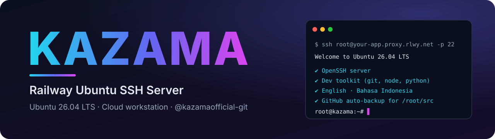
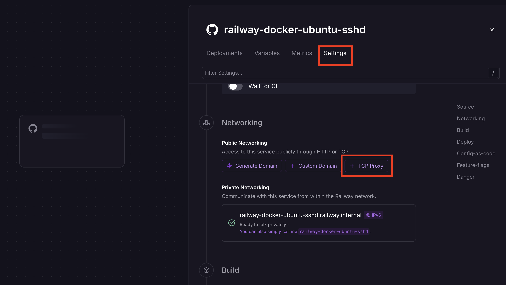
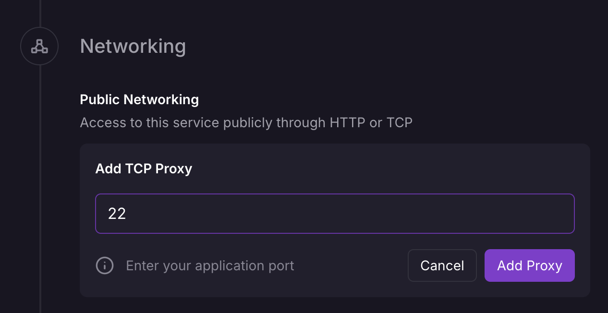
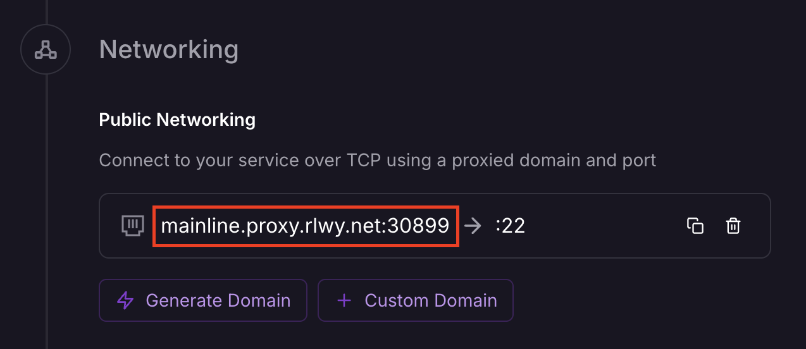

<p align="center">
  
</p>

<h1 align="center">Kazama — Railway Ubuntu SSH Server 🚂</h1>

<p align="center">
  <b>Your own cloud workstation on Railway</b> — SSH in as <b>root</b> on <b>Ubuntu 26.04 LTS</b>
  with a full developer toolkit, bilingual messages and optional GitHub auto-backup.
</p>

<p align="center">
  🇬🇧 English &nbsp;·&nbsp; 🇮🇩 <a href="README.id.md">Bahasa Indonesia</a>
</p>

<p align="center">
  
  
  
  
  
</p>

<p align="center">
  <a href="https://railway.com/new"></a>
</p>

---

A Docker image for **Railway** that gives you an **Ubuntu 26.04** container running an **OpenSSH server**, a **mandatory root password**, a complete developer toolkit, and an optional **private GitHub backup** of your work folder. Connect over SSH and use it as a portable cloud workstation.

## ✨ Features

- 🐧 **Ubuntu 26.04 LTS** base image
- 🔑 **Direct root login** over SSH, with a **mandatory `ROOT_PASSWORD`** — the container refuses to start without it
- 👤 Optional secondary **sudo user** (`SSH_USERNAME` / `SSH_PASSWORD`) and **SSH key login** (`AUTHORIZED_KEYS`)
- 🧰 Developer toolkit: `git`, `tmux`, `vim`/`nano`/`micro`, `htop`/`btop`, `ripgrep`, `bat`, `fd`, `jq`, `zsh`, Python 3, Node.js + npm, build tools
- ☁️ **`src-sync`** — auto-backs up `/root/src` to a **private** GitHub repo and restores it on every redeploy
- 📊 **`usage`** — Railway trial credit & uptime monitor
- 🌍 **English + Indonesian** — locales (`en_US.UTF-8`, `id_ID.UTF-8`) and runtime messages (`APP_LANG=id`)
- 🎨 Kazama login banner with live system info
- 🧹 Clean `rootfs/` overlay, `tini` as PID 1, ShellCheck + Docker build in CI

## ⚠️ Important

**Railway runs containers, not a VPS.** Anything stored in the container is **lost on every redeploy** — files, installed packages and config changes. Keep your work in `/root/src` and set `GITHUB_TOKEN` to have it backed up automatically, or attach a Railway Volume.

## 🚀 Deploy to Railway

1. **Fork** or clone this repository and connect it to a new **Railway** project.
2. Open **Variables** and set `ROOT_PASSWORD` (required).
3. Open **Settings → Networking → Public Networking** and click **TCP Proxy**.

   

4. Enter port **`22`** and press **Add Proxy**.

   

5. **Redeploy**. Railway now shows the domain and port to use:

   

6. Connect:

   ```bash
   ssh root@<your-railway-domain> -p <port>
   ```

   Type `yes` to accept the host key, then enter your `ROOT_PASSWORD`.

## 🌱 Environment variables

| Variable | Required | Default | Description |
|----------|:--------:|---------|-------------|
| `ROOT_PASSWORD` | ✅ | — | Password for **root**. The container will not start without it. |
| `SSH_USERNAME` | — | — | Optional secondary sudo user. Set together with `SSH_PASSWORD`. |
| `SSH_PASSWORD` | — | — | Password for the optional sudo user. |
| `AUTHORIZED_KEYS` | — | — | SSH public key(s) for root key-based login (password login stays on). |
| `GITHUB_TOKEN` | — | — | GitHub token (`repo` scope). Enables the `/root/src` ⇄ private repo backup. |
| `SYNC_INTERVAL` | — | `180` | Seconds between automatic backups (minimum 30). |
| `SRC_REPO` | — | — | Pin the backup repo name, e.g. to restore into a brand-new Railway project. |
| `RAILWAY_TOKEN` | — | — | Railway **account** token so `usage` can read your real remaining credit. |
| `APP_LANG` | — | `en` | Runtime message language: `en` or `id`. |

> 🔑 Need a GitHub token? Follow the step-by-step guide in **[docs/TOKENS.md](docs/TOKENS.md)**.

## ☁️ Backup your work — `src-sync`

Put your projects in **`/root/src`**. With `GITHUB_TOKEN` set, Kazama will:

1. create a **private** repo named `kazama-src-<railway-project-id>` on your account,
2. **restore** it into `/root/src` on every (re)deploy,
3. **push** changes every `SYNC_INTERVAL` seconds in the background.

```bash
src-sync              # back up now
src-sync restore      # pull the repo into /root/src
src-sync status       # show the linked repo and last commit
src-sync init         # (re)create / link the repo
```

A default `.gitignore` (`node_modules/`, `.venv/`, `*.log`, …) is added on the first backup. Your token is sent through an HTTP header per command — it is never written to the remote URL or `.git/config`.

## 📊 Railway usage — `usage`

```bash
usage
```

Shows trial credit used/remaining, burn rate and uptime left. Without a token it is an **estimate** from the container's CPU/RAM and runtime; set `RAILWAY_TOKEN` for live data. Rates and the trial amount can be overridden with `RAILWAY_VCPU_RATE`, `RAILWAY_MEM_RATE`, `RAILWAY_EGRESS_RATE` and `RAILWAY_TRIAL_CREDIT`.

## 🗂️ Project structure

```text
.
├── Dockerfile                      # Ubuntu 26.04 image (ARG UBUNTU_VERSION)
├── railway.json                    # Railway build/deploy config
├── railway-template.json           # Template manifest (service, variables, TCP proxy)
├── rootfs/                         # Copied 1:1 into the image
│   ├── etc/
│   │   ├── profile.d/kazama-welcome.sh      # SSH login banner
│   │   └── ssh/sshd_config.d/10-kazama.conf # sshd settings
│   └── usr/local/
│       ├── bin/
│       │   ├── kazama-entrypoint            # container start-up logic
│       │   ├── src-sync                     # GitHub backup / restore
│       │   └── usage                        # Railway usage monitor
│       └── lib/kazama/common.sh             # shared helpers (i18n, config, logging)
├── docs/                           # Token guides (EN / ID)
├── assets/                         # Banner + screenshots
└── .github/workflows/ci.yml        # ShellCheck + Docker build
```

## 📦 Included packages

| Group | Packages |
|-------|----------|
| Network | `curl` `wget` `iproute2` `iputils-ping` `net-tools` `dnsutils` `traceroute` `whois` `inetutils-telnet` `nmap` |
| Editors | `vim` `nano` `micro` |
| Monitoring | `htop` `btop` `ncdu` `fastfetch` |
| Terminal | `tmux` `screen` `less` `tree` `bat` `ripgrep` `fd-find` `jq` `zsh` |
| Archives | `unzip` `zip` `tar` `gzip` `bzip2` `xz-utils` `7zip` |
| Development | `git` `build-essential` `cmake` `pkg-config` `autoconf` `automake` `libtool` `python3` (`pip`, `venv`, `dev`) `nodejs` `npm` |
| Locales | `locales` `language-pack-en` `language-pack-id` |

`bat` and `fd` are linked to their short names. Anything else: `apt-get install <package>`.

## 🔒 Security

- **`ROOT_PASSWORD` is mandatory** — use a long, unique password and change it after first login.
- Prefer key-based login: set `AUTHORIZED_KEYS`, then consider disabling password login in `rootfs/etc/ssh/sshd_config.d/10-kazama.conf` for your own fork.
- Keep every token private — Railway Variables marked as secrets are masked.
- sshd allows 4 auth attempts per connection; idle connections are kept alive for Railway's TCP proxy.

## 🩺 Troubleshooting

| Problem | Fix |
|---------|-----|
| Cannot connect | Make sure a **TCP Proxy on port `22`** exists and use the domain **and port** shown by Railway. |
| Container crashes at start | `ROOT_PASSWORD` is missing — check the deploy logs. |
| `src-sync: GITHUB_TOKEN not set` | Set the variable and **redeploy once**; the token is stored at container start. |
| "failed to create repo" | The token needs the **`repo`** scope (classic token). |
| `usage` shows ESTIMATE | Set `RAILWAY_TOKEN` (account token) for live data. |
| Files disappeared after redeploy | Expected on Railway — use `/root/src` + `GITHUB_TOKEN`, or a Volume. |

## 🛠️ Build locally

```bash
docker build -t kazama-ssh .
docker run -d --name kazama -p 2222:22 -e ROOT_PASSWORD='change-me' kazama-ssh
ssh root@localhost -p 2222
```

## 📄 License

Released under the MIT License — see [LICENSE](LICENSE).

---

<p align="center">
  © Kazama · Developed by <a href="https://github.com/kazamaofficial-git"><b>@kazamaofficial-git</b></a> ·
  <a href="https://github.com/kazamaofficial-git/railway-ubuntu-ssh">Repository</a> · Built for Railway 🚂
</p>
